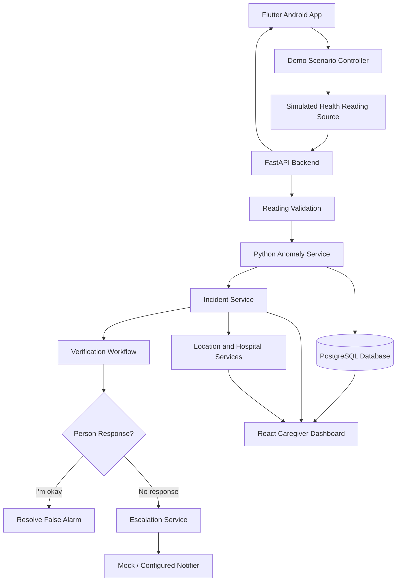
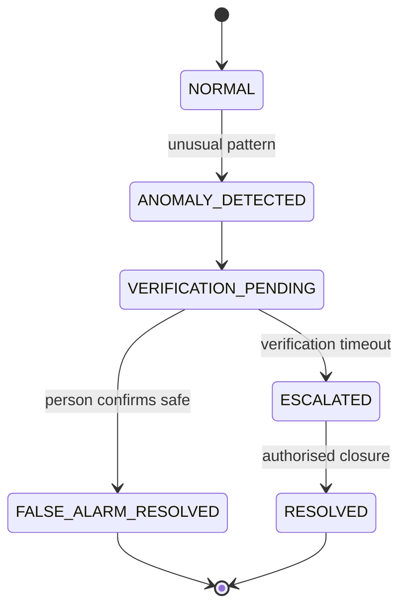

# SAHYOG — System Design

**Project:** SAHYOG — Detect. Verify. Respond.  
**Document:** SYSTEM_DESIGN.md  
**Version:** 1.0  
**Status:** Proposed architecture baseline

---

## 1. Architecture Overview

SAHYOG follows a client-server architecture with a Flutter Android application, FastAPI backend, PostgreSQL database and React caregiver dashboard.

The prototype uses simulated health readings. The architecture must allow future wearable integrations without requiring them now.

### 1.1 Technology Stack

| Component | Technology | Owner |
|---|---|---|
| Android mobile application | Flutter / Dart | Aditya |
| Health monitoring and detection | Python / Dart interfaces as approved | Prasiddh |
| Backend | Python / FastAPI | Shubhankar |
| Database and migrations | PostgreSQL / SQLAlchemy / Alembic, subject to existing repo | Utkarsh |
| Caregiver dashboard | React | Vaishnavi |
| Location services | Approved location provider and local fallback | Vaishnavi |
| Notification abstraction | Mock notifier for demo; real provider only if configured | Utkarsh |
| Hospital abstraction | Seeded/cached data and approved provider | Utkarsh + Vaishnavi |

Use the versions and dependencies already established in the repository. Do not upgrade the entire stack without approval.

## 2. High-Level Data Flow

The core data flow is:

1. The user opens the Android application.
2. The user selects one of the three demo scenarios.
3. The Flutter simulator generates deterministic simulated readings.
4. The mobile app submits readings to the backend using the approved reading API.
5. The backend validates the readings.
6. The backend anomaly service evaluates the readings.
7. If an anomaly is detected, the incident workflow is initiated.
8. The person is asked to confirm whether they are okay.
9. The backend receives the confirmation or processes the configured timeout.
10. The incident state is updated.
11. The notifier abstraction records or simulates escalation.
12. The caregiver dashboard retrieves the latest authoritative state.

The same pipeline is used for all three scenarios.

### 2.1 Component Diagram



The diagram describes logical responsibilities. Actual module names must follow the repository.

## 3. Important Architecture Decisions

### D1 — Simulated readings in the prototype

No physical smartwatch is connected in this version.

The mobile simulator is the reading source.

All generated readings must carry a source marker such as `SIMULATED`.

Future wearable support may introduce another implementation of the reading-source interface. It must not require rewriting the incident lifecycle.

### D2 — Backend-authoritative incident state

The backend is the authoritative source for:

- Whether an anomaly event has been accepted.
- Whether an incident exists.
- Whether verification is pending.
- Whether a false alarm has been resolved.
- Whether escalation has occurred.
- Whether the incident is closed.

The mobile app may display temporary loading and progress states, but it must not independently invent the final incident outcome.

### D3 — Backend-authoritative anomaly decision

For the prototype, the backend Python anomaly service is authoritative for incident-creating anomaly decisions.

The mobile application may contain interfaces, buffers or preview logic where required by the existing architecture, but it must not independently create a competing incident decision.

If local detection is retained, its purpose and relationship to the backend detector must be explicitly documented and tested.

### D4 — Shared scenario pipeline

The three scenarios are not three different applications or separate hardcoded workflows.

Each scenario generates a different sequence of inputs and uses the same reading, detection, incident, verification and dashboard services.

### D5 — External services are optional

The core demo must run with:

- Local backend.
- Local database.
- Seeded hospital data.
- Mock notifications.
- Local dashboard.
- Android simulator source.

External services must not be mandatory for the primary demonstration.

## 4. Scenario Execution Design

### 4.1 Scenario identifiers

Use exactly these scenario identifiers unless the existing repository already has a formally approved equivalent:

- `NORMAL`
- `TRUE_ANOMALY`
- `FALSE_ALARM`

Use a unique `demo_run_id` for every execution.

Every simulated reading and incident generated by a scenario must be traceable to its demo run.

### 4.2 Scenario timing

Target duration: approximately 60 seconds.

Suggested timing, configurable from one shared scenario configuration:

| Phase | Approximate time |
|---|---:|
| Start and baseline readings | 0–10 seconds |
| Scenario-specific readings | 10–30 seconds |
| Detection and verification | 30–45 seconds |
| Confirmation or timeout | 45–55 seconds |
| Final status and dashboard update | 55–60 seconds |

The exact timing may be adjusted after testing.

Do not hardcode unrelated timers in the mobile app, backend and dashboard.

The backend's verification timeout must be configurable. The true-anomaly scenario must use a short demo timeout so the full workflow can be shown in approximately one minute.

### 4.3 Normal scenario

- Generate normal readings.
- Send them through the reading API.
- Validate them.
- Run the detector.
- Do not create an incident.
- Complete the demo run with a normal outcome.

### 4.4 True-anomaly scenario

- Generate normal initial readings.
- Generate a sustained unusual pattern.
- Submit readings through the same API.
- Detect the anomaly.
- Create an incident.
- Start verification.
- Simulate no response.
- Process the verification timeout.
- Initiate escalation.
- Update the dashboard.

### 4.5 False-alarm scenario

- Generate normal initial readings.
- Generate a pattern that triggers anomaly detection.
- Create an incident.
- Start verification.
- Allow the user to press "I'm okay".
- Record the response.
- Cancel pending escalation.
- Resolve the incident as a false alarm.
- Update the dashboard.

The user confirmation must be a real application action that reaches the backend, not a local animation.

## 5. Backend Module Responsibilities

The backend should separate the following logical responsibilities:

- API routing.
- Request and response schemas.
- Authentication and authorization.
- Reading validation.
- Anomaly detection.
- Incident lifecycle.
- Verification processing.
- Escalation orchestration.
- Notification provider abstraction.
- Hospital provider abstraction.
- Location processing.
- Database access.
- Background timeout processing.

Use the existing package structure where possible.

Do not create duplicate services that perform the same job.

## 6. API Contract

The following is the proposed canonical API contract for the prototype. Before implementation, compare it with existing FastAPI routes and SYSTEM_DESIGN history. If the repository already contains an approved equivalent, preserve the existing contract and update this document instead of introducing duplicate routes.

All endpoints use the `/api/v1` prefix unless the existing application has an established prefix.

All timestamps must use ISO 8601 UTC timestamps.

All identifiers must use the identifier format established by the database models.

### 6.1 Create a demo run

`POST /api/v1/demo/runs`

Purpose: Start one of the three demo scenarios.

Example request:

```json
{
  "scenario": "NORMAL"
}
```

Allowed values:

- `NORMAL`
- `TRUE_ANOMALY`
- `FALSE_ALARM`

Example response:

```json
{
  "demo_run_id": "run_example_001",
  "scenario": "NORMAL",
  "status": "RUNNING",
  "started_at": "2026-11-23T10:00:00Z"
}
```

Requirements:

- Generate a unique run ID.
- Prevent conflicting runs for the same demo subject where required.
- Do not silently reuse an old run.
- Return a validation error for unsupported scenarios.
- A repeated request must not accidentally create duplicate active runs.

### 6.2 Submit a health reading

`POST /api/v1/readings`

Purpose: Submit one simulated health sample.

Example request:

```json
{
  "demo_run_id": "run_example_001",
  "source": "SIMULATED",
  "timestamp": "2026-11-23T10:00:03Z",
  "heart_rate_bpm": 78,
  "activity": "RESTING"
}
```

This is an illustrative contract. Add or remove fields only according to the actual approved reading model.

Requirements:

- Validate the run ID.
- Validate source.
- Validate units and value ranges.
- Validate timestamp.
- Reject malformed readings safely.
- Pass valid readings to the anomaly service.
- Associate any resulting event with the same demo run.
- Prevent duplicate processing where an idempotency mechanism is required.

Example response:

```json
{
  "reading_id": "reading_example_001",
  "demo_run_id": "run_example_001",
  "accepted": true,
  "detection_status": "NORMAL"
}
```

Possible detection results must follow the approved schema. The example values are not a substitute for the actual Pydantic schema.

### 6.3 Retrieve demo-run status

`GET /api/v1/demo/runs/{demo_run_id}`

Purpose: Retrieve the current state of a scenario.

The response should include:

- Demo run ID.
- Scenario.
- Run status.
- Start time.
- Completion time, if available.
- Latest detection status.
- Related incident ID, if one exists.
- Final outcome, if complete.

### 6.4 Cancel or reset a demo run

`POST /api/v1/demo/runs/{demo_run_id}/reset`

Purpose: Safely stop/reset an active demonstration.

Requirements:

- Stop or invalidate pending demo processing.
- Cancel pending demo-only escalation tasks.
- Preserve unrelated user data.
- Mark or clean demo data according to the approved retention/reset policy.
- Prevent a previous run from changing the state of a new run.

If the existing architecture uses a different reset method, document it and use one canonical approach.

### 6.5 Retrieve dashboard overview

`GET /api/v1/dashboard/overview`

Purpose: Provide the dashboard with authorised summary data.

The response should include:

- Monitored-person status.
- Latest readings.
- Active incident summary.
- Verification status.
- Escalation status.
- Latest location if available.
- Latest update timestamp.

Only return information the authenticated caregiver is authorised to view.

### 6.6 Retrieve incidents

`GET /api/v1/incidents`

Optional filters may include:

- `demo_run_id`
- `status`
- Pagination parameters

Purpose: Return authorised incident records.

Use bounded result limits.

### 6.7 Retrieve a single incident

`GET /api/v1/incidents/{incident_id}`

Purpose: Return incident details and its timeline.

### 6.8 Submit verification response

`POST /api/v1/incidents/{incident_id}/verification`

Example request:

```json
{
  "response": "I_AM_OK"
}
```

The allowed response values must be defined in the shared schema.

Requirements:

- Authenticate and authorise the person submitting the response.
- Validate that the incident is awaiting verification.
- Record the response and timestamp.
- Cancel pending escalation.
- Update the incident state.
- Return the authoritative updated incident state.

A repeated confirmation must not create duplicate resolution events.

### 6.9 Location and hospital endpoints

Vaishnavi and Shubhankar must reconcile these routes with the existing design.

The canonical responsibility is:

- Location routes accept and retrieve authorised location information.
- Hospital routes return hospital information from the approved provider or seeded data.
- The dashboard consumes the same response contract.
- No second implementation of hospital discovery should be created in the notifier.

Exact paths must follow the existing approved route structure.

## 7. Shared Data Contracts

### 7.1 Health reading

A health reading must include the fields required by the approved model:

- Reading identifier.
- Demo-run identifier when simulated.
- Subject/user identifier.
- Source.
- Timestamp.
- Reading value.
- Unit.
- Activity/context where available.

For the initial heart-rate-only demonstration, use beats per minute (`bpm`).

Never silently mix units.

### 7.2 Anomaly event

An anomaly event should contain:

- Event ID.
- Demo-run ID.
- Subject ID.
- Detection timestamp.
- Detector result.
- Severity, if defined.
- Explanation/reason.
- Relevant reading references or summary.
- Detector version or configuration reference, if supported.

### 7.3 Incident

An incident should contain:

- Incident ID.
- Subject ID.
- Demo-run ID when applicable.
- Created timestamp.
- Current status.
- Related anomaly event.
- Verification details.
- Escalation details.
- Location reference where available.
- Resolution details.

### 7.4 Notification result

A notification result must distinguish:

- `SIMULATED`
- `SENT`
- `FAILED`
- Other provider-defined states, if approved.

A mock notification must never be represented as a successfully delivered real SMS or call.

## 8. Incident Lifecycle

Use one canonical state vocabulary across the backend, mobile app and dashboard.

Proposed lifecycle:



The exact stored enum names must be agreed with Utkarsh and Shubhankar before implementation.

Rules:

- A normal reading does not create an incident.
- An anomaly creates or updates the appropriate incident.
- Verification is required before the demo's no-response escalation.
- Confirmation cancels pending escalation.
- Escalation is only recorded after the backend processes the timeout.
- Invalid transitions must be rejected.
- Terminal states must not silently return to active states.

## 9. AI/ML Design

The backend detector is the authoritative decision-maker for incident-creating anomaly events.

Pipeline:

1. Validate reading.
2. Check freshness.
3. Check data quality.
4. Apply baseline/context.
5. Calculate relevant statistics or model features.
6. Evaluate the anomaly.
7. Apply persistence/duration checks.
8. Generate an anomaly event if appropriate.
9. Pass the event to the incident service.

The detector must handle:

- Normal readings.
- Spikes.
- Drops.
- Sustained deviations.
- Noisy measurements.
- Missing samples.
- Stale samples.
- Out-of-order samples.
- Insufficient baseline data.

Use thresholds that are explicitly labelled as demo parameters.

Do not present them as clinical thresholds.

Do not train a model on synthetic demo values and then claim clinical performance.

## 10. Database Design

Utkarsh owns database models and migrations.

The logical entities may include:

- User.
- Profile.
- EmergencyContact.
- HealthReading.
- AnomalyEvent.
- Incident.
- VerificationResponse.
- EscalationRecord.
- LocationRecord, if persistence is required.
- DemoRun.
- NotificationRecord, if persistence is required.

Use only the entities necessary for the approved workflow.

Requirements:

- Unique primary identifiers.
- Appropriate foreign keys.
- Required indexes.
- Timestamps.
- Constraints.
- Safe migrations.
- Bounded query patterns.
- Demo-run isolation.
- Appropriate retention of simulated data.

Do not store unnecessary personal or medical information.

## 11. Frontend Architecture

### Android app

Responsibilities:

- Display the monitoring state.
- Present the three demo scenarios.
- Start and stop a scenario.
- Generate simulated readings through the approved simulator interface.
- Send readings to the backend.
- Display detector and incident states returned by the backend.
- Allow the person to confirm they are okay.
- Display errors and loading states.
- Show clearly labelled simulated data.

### Caregiver dashboard

Responsibilities:

- Authenticate as an authorised caregiver where required.
- Retrieve dashboard data.
- Display incidents and their lifecycle.
- Display reading summaries.
- Display location and hospital information where available.
- Reflect false-alarm resolution and escalation.
- Handle missing or unavailable data.

## 12. Real-Time Updates and Polling

Use the update method already approved by the repository.

If WebSockets are implemented:

- Define one event schema.
- Authenticate connections.
- Handle disconnects.
- Reconnect with bounded backoff.
- Avoid duplicate subscriptions.
- Release resources.

If WebSockets are not ready:

- Use controlled polling.
- Use a sensible interval.
- Stop polling when the screen is inactive.
- Avoid polling more frequently than necessary.
- Use bounded response sizes.

The demo must not depend on an uncontrolled refresh loop.

## 13. Location and Hospital Architecture

Location must be permission-based and authorised.

Hospital data should be obtained through one shared hospital-service abstraction.

For offline demonstrations:

- Seed a small dataset of clearly identified demonstration hospitals.
- Store coordinates and other supported fields.
- Use cached data when available.
- Display the data's source or simulated status.
- Handle no-result cases.

Do not claim that the listed hospital is available, open, responding or accepting a patient unless verified.

Do not make external map tiles or live geocoding mandatory for the demo.

## 14. Notification Architecture

The notification service must have a stable interface.

The hackathon default should be a mock notifier that records:

- Incident ID.
- Intended recipient.
- Notification type.
- Simulated result.
- Timestamp.

Real providers may be added through configuration.

Never hardcode provider credentials.

Never claim a real notification was delivered when only the mock notifier ran.

## 15. Security

- Use the approved authentication mechanism.
- Verify ownership and caregiver permissions.
- Validate every input.
- Keep secrets outside source control.
- Use HTTPS for hosted production environments.
- Do not expose database credentials in the mobile app.
- Avoid logging personal health details.
- Protect location information.
- Restrict demo reset operations.
- Do not allow one user to access another user's incidents.

## 16. Deployment Design

### Local demonstration

The core local environment should include:

- PostgreSQL.
- FastAPI backend.
- React dashboard.
- Flutter Android app.
- Seeded demo data.
- Mock notification service.

The Android phone may connect to a backend running on a laptop through the same local network.

Document the correct backend URL for:

- Android emulator.
- Physical Android device.
- Local web dashboard.
- Hosted environment.

Do not assume `localhost` on an Android phone points to the development laptop.

### Hosted environment

If a hosted backend is used:

- Use HTTPS.
- Configure environment variables.
- Apply migrations safely.
- Configure database access.
- Configure CORS.
- Configure logs and health checks.
- Do not expose development credentials.
- Keep a local fallback for the hackathon.

## 17. Error Handling

Use consistent API errors.

An error should contain:

- Stable error code.
- Human-readable message.
- Optional field-level validation details.
- Request/correlation identifier where available.

Do not expose internal stack traces to the client.

Handle:

- Invalid input.
- Authentication failure.
- Permission failure.
- Missing resources.
- Duplicate requests.
- Database errors.
- External-service failures.
- Timeout.
- Backend unavailable.

## 18. Testing Architecture

Required test layers:

### Unit tests
- Detector.
- Reading validation.
- Incident transitions.
- Verification.
- Escalation cancellation.
- Hospital/location formatting.

### Integration tests
- Reading API to detector.
- Detector to incident service.
- Verification to incident resolution.
- Timeout to escalation.
- Database persistence.
- Dashboard API.

### End-to-end tests
- Normal.
- True anomaly.
- False alarm.
- Repeated runs.
- Server restart and recovery.
- Missing external services.

### Mobile tests
- Scenario selection.
- Reading display.
- Verification action.
- Network failure.
- App lifecycle.
- Physical-device installation.

## 19. Final Architecture Acceptance

The architecture is accepted only when:

1. All components use the agreed contracts.
2. The backend owns authoritative incident state.
3. The backend detector controls incident-creating anomaly decisions.
4. The three scenarios use the same pipeline.
5. The database can be created from migrations.
6. The dashboard reflects backend state.
7. Location and hospital fallback work.
8. Mock notifications are clearly identified.
9. The app can replay scenarios.
10. The local demo does not depend on external internet services.

# SAHYOG — System Design

**Project:** SAHYOG — Detect. Verify. Respond.  
**Document:** SYSTEM_DESIGN.md  
**Version:** 1.0  
**Status:** Proposed architecture baseline

---

## 1. Architecture Overview

SAHYOG follows a client-server architecture with a Flutter Android application, FastAPI backend, PostgreSQL database and React caregiver dashboard.

The prototype uses simulated health readings. The architecture must allow future wearable integrations without requiring them now.

### 1.1 Technology Stack

| Component | Technology | Owner |
|---|---|---|
| Android mobile application | Flutter / Dart | Aditya |
| Health monitoring and detection | Python / Dart interfaces as approved | Prasiddh |
| Backend | Python / FastAPI | Shubhankar |
| Database and migrations | PostgreSQL / SQLAlchemy / Alembic, subject to existing repo | Utkarsh |
| Caregiver dashboard | React | Vaishnavi |
| Location services | Approved location provider and local fallback | Vaishnavi |
| Notification abstraction | Mock notifier for demo; real provider only if configured | Utkarsh |
| Hospital abstraction | Seeded/cached data and approved provider | Utkarsh + Vaishnavi |

Use the versions and dependencies already established in the repository. Do not upgrade the entire stack without approval.

## 2. High-Level Data Flow

The core data flow is:

1. The user opens the Android application.
2. The user selects one of the three demo scenarios.
3. The Flutter simulator generates deterministic simulated readings.
4. The mobile app submits readings to the backend using the approved reading API.
5. The backend validates the readings.
6. The backend anomaly service evaluates the readings.
7. If an anomaly is detected, the incident workflow is initiated.
8. The person is asked to confirm whether they are okay.
9. The backend receives the confirmation or processes the configured timeout.
10. The incident state is updated.
11. The notifier abstraction records or simulates escalation.
12. The caregiver dashboard retrieves the latest authoritative state.

The same pipeline is used for all three scenarios.

### 2.1 Component Diagram


The diagram describes logical responsibilities. Actual module names must follow the repository.

## 3. Important Architecture Decisions

### D1 — Simulated readings in the prototype

No physical smartwatch is connected in this version.

The mobile simulator is the reading source.

All generated readings must carry a source marker such as `SIMULATED`.

Future wearable support may introduce another implementation of the reading-source interface. It must not require rewriting the incident lifecycle.

### D2 — Backend-authoritative incident state

The backend is the authoritative source for:

- Whether an anomaly event has been accepted.
- Whether an incident exists.
- Whether verification is pending.
- Whether a false alarm has been resolved.
- Whether escalation has occurred.
- Whether the incident is closed.

The mobile app may display temporary loading and progress states, but it must not independently invent the final incident outcome.

### D3 — Backend-authoritative anomaly decision

For the prototype, the backend Python anomaly service is authoritative for incident-creating anomaly decisions.

The mobile application may contain interfaces, buffers or preview logic where required by the existing architecture, but it must not independently create a competing incident decision.

If local detection is retained, its purpose and relationship to the backend detector must be explicitly documented and tested.

### D4 — Shared scenario pipeline

The three scenarios are not three different applications or separate hardcoded workflows.

Each scenario generates a different sequence of inputs and uses the same reading, detection, incident, verification and dashboard services.

### D5 — External services are optional

The core demo must run with:

- Local backend.
- Local database.
- Seeded hospital data.
- Mock notifications.
- Local dashboard.
- Android simulator source.

External services must not be mandatory for the primary demonstration.

## 4. Scenario Execution Design

### 4.1 Scenario identifiers

Use exactly these scenario identifiers unless the existing repository already has a formally approved equivalent:

- `NORMAL`
- `TRUE_ANOMALY`
- `FALSE_ALARM`

Use a unique `demo_run_id` for every execution.

Every simulated reading and incident generated by a scenario must be traceable to its demo run.

### 4.2 Scenario timing

Target duration: approximately 60 seconds.

Suggested timing, configurable from one shared scenario configuration:

| Phase | Approximate time |
|---|---:|
| Start and baseline readings | 0–10 seconds |
| Scenario-specific readings | 10–30 seconds |
| Detection and verification | 30–45 seconds |
| Confirmation or timeout | 45–55 seconds |
| Final status and dashboard update | 55–60 seconds |

The exact timing may be adjusted after testing.

Do not hardcode unrelated timers in the mobile app, backend and dashboard.

The backend's verification timeout must be configurable. The true-anomaly scenario must use a short demo timeout so the full workflow can be shown in approximately one minute.

### 4.3 Normal scenario

- Generate normal readings.
- Send them through the reading API.
- Validate them.
- Run the detector.
- Do not create an incident.
- Complete the demo run with a normal outcome.

### 4.4 True-anomaly scenario

- Generate normal initial readings.
- Generate a sustained unusual pattern.
- Submit readings through the same API.
- Detect the anomaly.
- Create an incident.
- Start verification.
- Simulate no response.
- Process the verification timeout.
- Initiate escalation.
- Update the dashboard.

### 4.5 False-alarm scenario

- Generate normal initial readings.
- Generate a pattern that triggers anomaly detection.
- Create an incident.
- Start verification.
- Allow the user to press "I'm okay".
- Record the response.
- Cancel pending escalation.
- Resolve the incident as a false alarm.
- Update the dashboard.

The user confirmation must be a real application action that reaches the backend, not a local animation.

## 5. Backend Module Responsibilities

The backend should separate the following logical responsibilities:

- API routing.
- Request and response schemas.
- Authentication and authorization.
- Reading validation.
- Anomaly detection.
- Incident lifecycle.
- Verification processing.
- Escalation orchestration.
- Notification provider abstraction.
- Hospital provider abstraction.
- Location processing.
- Database access.
- Background timeout processing.

Use the existing package structure where possible.

Do not create duplicate services that perform the same job.

## 6. API Contract

The following is the proposed canonical API contract for the prototype. Before implementation, compare it with existing FastAPI routes and SYSTEM_DESIGN history. If the repository already contains an approved equivalent, preserve the existing contract and update this document instead of introducing duplicate routes.

All endpoints use the `/api/v1` prefix unless the existing application has an established prefix.

All timestamps must use ISO 8601 UTC timestamps.

All identifiers must use the identifier format established by the database models.

### 6.1 Create a demo run

`POST /api/v1/demo/runs`

Purpose: Start one of the three demo scenarios.

Example request:

```json
{
  "scenario": "NORMAL"
}
```

Allowed values:

- `NORMAL`
- `TRUE_ANOMALY`
- `FALSE_ALARM`

Example response:

```json
{
  "demo_run_id": "run_example_001",
  "scenario": "NORMAL",
  "status": "RUNNING",
  "started_at": "2026-11-23T10:00:00Z"
}
```

Requirements:

- Generate a unique run ID.
- Prevent conflicting runs for the same demo subject where required.
- Do not silently reuse an old run.
- Return a validation error for unsupported scenarios.
- A repeated request must not accidentally create duplicate active runs.

### 6.2 Submit a health reading

`POST /api/v1/readings`

Purpose: Submit one simulated health sample.

Example request:

```json
{
  "demo_run_id": "run_example_001",
  "source": "SIMULATED",
  "timestamp": "2026-11-23T10:00:03Z",
  "heart_rate_bpm": 78,
  "activity": "RESTING"
}
```

This is an illustrative contract. Add or remove fields only according to the actual approved reading model.

Requirements:

- Validate the run ID.
- Validate source.
- Validate units and value ranges.
- Validate timestamp.
- Reject malformed readings safely.
- Pass valid readings to the anomaly service.
- Associate any resulting event with the same demo run.
- Prevent duplicate processing where an idempotency mechanism is required.

Example response:

```json
{
  "reading_id": "reading_example_001",
  "demo_run_id": "run_example_001",
  "accepted": true,
  "detection_status": "NORMAL"
}
```

Possible detection results must follow the approved schema. The example values are not a substitute for the actual Pydantic schema.

### 6.3 Retrieve demo-run status

`GET /api/v1/demo/runs/{demo_run_id}`

Purpose: Retrieve the current state of a scenario.

The response should include:

- Demo run ID.
- Scenario.
- Run status.
- Start time.
- Completion time, if available.
- Latest detection status.
- Related incident ID, if one exists.
- Final outcome, if complete.

### 6.4 Cancel or reset a demo run

`POST /api/v1/demo/runs/{demo_run_id}/reset`

Purpose: Safely stop/reset an active demonstration.

Requirements:

- Stop or invalidate pending demo processing.
- Cancel pending demo-only escalation tasks.
- Preserve unrelated user data.
- Mark or clean demo data according to the approved retention/reset policy.
- Prevent a previous run from changing the state of a new run.

If the existing architecture uses a different reset method, document it and use one canonical approach.

### 6.5 Retrieve dashboard overview

`GET /api/v1/dashboard/overview`

Purpose: Provide the dashboard with authorised summary data.

The response should include:

- Monitored-person status.
- Latest readings.
- Active incident summary.
- Verification status.
- Escalation status.
- Latest location if available.
- Latest update timestamp.

Only return information the authenticated caregiver is authorised to view.

### 6.6 Retrieve incidents

`GET /api/v1/incidents`

Optional filters may include:

- `demo_run_id`
- `status`
- Pagination parameters

Purpose: Return authorised incident records.

Use bounded result limits.

### 6.7 Retrieve a single incident

`GET /api/v1/incidents/{incident_id}`

Purpose: Return incident details and its timeline.

### 6.8 Submit verification response

`POST /api/v1/incidents/{incident_id}/verification`

Example request:

```json
{
  "response": "I_AM_OK"
}
```

The allowed response values must be defined in the shared schema.

Requirements:

- Authenticate and authorise the person submitting the response.
- Validate that the incident is awaiting verification.
- Record the response and timestamp.
- Cancel pending escalation.
- Update the incident state.
- Return the authoritative updated incident state.

A repeated confirmation must not create duplicate resolution events.

### 6.9 Location and hospital endpoints

Vaishnavi and Shubhankar must reconcile these routes with the existing design.

The canonical responsibility is:

- Location routes accept and retrieve authorised location information.
- Hospital routes return hospital information from the approved provider or seeded data.
- The dashboard consumes the same response contract.
- No second implementation of hospital discovery should be created in the notifier.

Exact paths must follow the existing approved route structure.

## 7. Shared Data Contracts

### 7.1 Health reading

A health reading must include the fields required by the approved model:

- Reading identifier.
- Demo-run identifier when simulated.
- Subject/user identifier.
- Source.
- Timestamp.
- Reading value.
- Unit.
- Activity/context where available.

For the initial heart-rate-only demonstration, use beats per minute (`bpm`).

Never silently mix units.

### 7.2 Anomaly event

An anomaly event should contain:

- Event ID.
- Demo-run ID.
- Subject ID.
- Detection timestamp.
- Detector result.
- Severity, if defined.
- Explanation/reason.
- Relevant reading references or summary.
- Detector version or configuration reference, if supported.

### 7.3 Incident

An incident should contain:

- Incident ID.
- Subject ID.
- Demo-run ID when applicable.
- Created timestamp.
- Current status.
- Related anomaly event.
- Verification details.
- Escalation details.
- Location reference where available.
- Resolution details.

### 7.4 Notification result

A notification result must distinguish:

- `SIMULATED`
- `SENT`
- `FAILED`
- Other provider-defined states, if approved.

A mock notification must never be represented as a successfully delivered real SMS or call.

## 8. Incident Lifecycle

Use one canonical state vocabulary across the backend, mobile app and dashboard.

Proposed lifecycle:


The exact stored enum names must be agreed with Utkarsh and Shubhankar before implementation.

Rules:

- A normal reading does not create an incident.
- An anomaly creates or updates the appropriate incident.
- Verification is required before the demo's no-response escalation.
- Confirmation cancels pending escalation.
- Escalation is only recorded after the backend processes the timeout.
- Invalid transitions must be rejected.
- Terminal states must not silently return to active states.

## 9. AI/ML Design

The backend detector is the authoritative decision-maker for incident-creating anomaly events.

Pipeline:

1. Validate reading.
2. Check freshness.
3. Check data quality.
4. Apply baseline/context.
5. Calculate relevant statistics or model features.
6. Evaluate the anomaly.
7. Apply persistence/duration checks.
8. Generate an anomaly event if appropriate.
9. Pass the event to the incident service.

The detector must handle:

- Normal readings.
- Spikes.
- Drops.
- Sustained deviations.
- Noisy measurements.
- Missing samples.
- Stale samples.
- Out-of-order samples.
- Insufficient baseline data.

Use thresholds that are explicitly labelled as demo parameters.

Do not present them as clinical thresholds.

Do not train a model on synthetic demo values and then claim clinical performance.

## 10. Database Design

Utkarsh owns database models and migrations.

The logical entities may include:

- User.
- Profile.
- EmergencyContact.
- HealthReading.
- AnomalyEvent.
- Incident.
- VerificationResponse.
- EscalationRecord.
- LocationRecord, if persistence is required.
- DemoRun.
- NotificationRecord, if persistence is required.

Use only the entities necessary for the approved workflow.

Requirements:

- Unique primary identifiers.
- Appropriate foreign keys.
- Required indexes.
- Timestamps.
- Constraints.
- Safe migrations.
- Bounded query patterns.
- Demo-run isolation.
- Appropriate retention of simulated data.

Do not store unnecessary personal or medical information.

## 11. Frontend Architecture

### Android app

Responsibilities:

- Display the monitoring state.
- Present the three demo scenarios.
- Start and stop a scenario.
- Generate simulated readings through the approved simulator interface.
- Send readings to the backend.
- Display detector and incident states returned by the backend.
- Allow the person to confirm they are okay.
- Display errors and loading states.
- Show clearly labelled simulated data.

### Caregiver dashboard

Responsibilities:

- Authenticate as an authorised caregiver where required.
- Retrieve dashboard data.
- Display incidents and their lifecycle.
- Display reading summaries.
- Display location and hospital information where available.
- Reflect false-alarm resolution and escalation.
- Handle missing or unavailable data.

## 12. Real-Time Updates and Polling

Use the update method already approved by the repository.

If WebSockets are implemented:

- Define one event schema.
- Authenticate connections.
- Handle disconnects.
- Reconnect with bounded backoff.
- Avoid duplicate subscriptions.
- Release resources.

If WebSockets are not ready:

- Use controlled polling.
- Use a sensible interval.
- Stop polling when the screen is inactive.
- Avoid polling more frequently than necessary.
- Use bounded response sizes.

The demo must not depend on an uncontrolled refresh loop.

## 13. Location and Hospital Architecture

Location must be permission-based and authorised.

Hospital data should be obtained through one shared hospital-service abstraction.

For offline demonstrations:

- Seed a small dataset of clearly identified demonstration hospitals.
- Store coordinates and other supported fields.
- Use cached data when available.
- Display the data's source or simulated status.
- Handle no-result cases.

Do not claim that the listed hospital is available, open, responding or accepting a patient unless verified.

Do not make external map tiles or live geocoding mandatory for the demo.

## 14. Notification Architecture

The notification service must have a stable interface.

The hackathon default should be a mock notifier that records:

- Incident ID.
- Intended recipient.
- Notification type.
- Simulated result.
- Timestamp.

Real providers may be added through configuration.

Never hardcode provider credentials.

Never claim a real notification was delivered when only the mock notifier ran.

## 15. Security

- Use the approved authentication mechanism.
- Verify ownership and caregiver permissions.
- Validate every input.
- Keep secrets outside source control.
- Use HTTPS for hosted production environments.
- Do not expose database credentials in the mobile app.
- Avoid logging personal health details.
- Protect location information.
- Restrict demo reset operations.
- Do not allow one user to access another user's incidents.

## 16. Deployment Design

### Local demonstration

The core local environment should include:

- PostgreSQL.
- FastAPI backend.
- React dashboard.
- Flutter Android app.
- Seeded demo data.
- Mock notification service.

The Android phone may connect to a backend running on a laptop through the same local network.

Document the correct backend URL for:

- Android emulator.
- Physical Android device.
- Local web dashboard.
- Hosted environment.

Do not assume `localhost` on an Android phone points to the development laptop.

### Hosted environment

If a hosted backend is used:

- Use HTTPS.
- Configure environment variables.
- Apply migrations safely.
- Configure database access.
- Configure CORS.
- Configure logs and health checks.
- Do not expose development credentials.
- Keep a local fallback for the hackathon.

## 17. Error Handling

Use consistent API errors.

An error should contain:

- Stable error code.
- Human-readable message.
- Optional field-level validation details.
- Request/correlation identifier where available.

Do not expose internal stack traces to the client.

Handle:

- Invalid input.
- Authentication failure.
- Permission failure.
- Missing resources.
- Duplicate requests.
- Database errors.
- External-service failures.
- Timeout.
- Backend unavailable.

## 18. Testing Architecture

Required test layers:

### Unit tests
- Detector.
- Reading validation.
- Incident transitions.
- Verification.
- Escalation cancellation.
- Hospital/location formatting.

### Integration tests
- Reading API to detector.
- Detector to incident service.
- Verification to incident resolution.
- Timeout to escalation.
- Database persistence.
- Dashboard API.

### End-to-end tests
- Normal.
- True anomaly.
- False alarm.
- Repeated runs.
- Server restart and recovery.
- Missing external services.

### Mobile tests
- Scenario selection.
- Reading display.
- Verification action.
- Network failure.
- App lifecycle.
- Physical-device installation.

## 19. Final Architecture Acceptance

The architecture is accepted only when:

1. All components use the agreed contracts.
2. The backend owns authoritative incident state.
3. The backend detector controls incident-creating anomaly decisions.
4. The three scenarios use the same pipeline.
5. The database can be created from migrations.
6. The dashboard reflects backend state.
7. Location and hospital fallback work.
8. Mock notifications are clearly identified.
9. The app can replay scenarios.
10. The local demo does not depend on external internet services.

**End of SYSTEM_DESIGN.md**