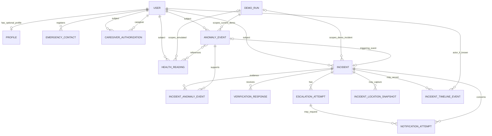

# SAHYOG — Logical Database Architecture and Schema Proposal

**Status:** Logical design proposal; the physical mapping is approved in `docs/PHYSICAL_DATABASE_SCHEMA.md`
**Owner:** Role 5 — Software Integration Lead + Database Engineer
**Scope:** Logical entities, contracts, integrity, lifecycle, isolation, privacy, and implementation dependencies

> This document records the logical design and does not independently define API contracts or runtime behavior. The physical schema implementation status is summarized below; unresolved decisions remain proposals or require owner confirmation.

## 1. Scope, sources, and decision labels

This proposal uses `PRD.md`, `SYSTEM_DESIGN.md`, `TEAM.md`, `Agents.md`, `HandOff.md`, `README.md`, and `docs/PHASE_0A_FOUNDATION.md`, plus the Role 5 Phase 0A discovery report and the architectural decisions supplied for this task.

Decision labels have these meanings:

- **CONFIRMED** — explicit in an authoritative project document or in the user's approved architectural decisions.
- **PROPOSED** — a recommended design choice where the sources do not establish an exact implementation.
- **UNRESOLVED** — requires a named owner or team decision before implementation.

**CONFIRMED:** The repository baseline is PostgreSQL 16, synchronous SQLAlchemy 2.x, Psycopg 3, and Alembic. Role 5 owns models, migrations, and database infrastructure. Shubhankar owns application configuration and database engine/session bootstrap.

**CONFIRMED:** Health input has two conceptual layers: source-compatible input and canonical SAHYOG data. The prototype is software-only, uses simulated readings, starts with heart rate in BPM, and does not commit to an external health-data API. A reading, anomaly event, incident, verification response, escalation attempt, and notification attempt are distinct concepts. Emergency-contact registration is separate from caregiver authorization/consent. Demo reset must preserve ordinary user and monitoring records.

### Historical implementation baseline

At the original review baseline, the backend contained only its dependency manifest, lockfile, and metadata test. That statement is historical and does not describe the current repository state.

### Current implementation status

- Nine SQLAlchemy ORM models share `Base.metadata`; Alembic configuration, environment, and the initial migration exist.
- The migration transaction-boundary fix is present in `backend/migrations/env.py`; its test checks that the role-verification transaction ends before Alembic starts its migration transaction.
- As reported for this closeout, the initial migration has been applied to `sahyog_dev` and `sahyog_test`.
- Application engine/session integration, runtime persistence operations, and application-level database DML permission provisioning remain pending. This logical document does not define API contracts or claim those runtime interfaces exist.

## 2. Architecture decisions and constraints

### Current prototype

- **CONFIRMED:** The application demonstrates `NORMAL`, `TRUE_ANOMALY`, and `FALSE_ALARM` with simulated data through one processing pipeline.
- **CONFIRMED:** The backend is authoritative for incident state and incident-creating anomaly decisions.
- **CONFIRMED:** Initial health monitoring is heart-rate-only and uses `bpm`.
- **CONFIRMED:** Normal monitoring data and simulated demo data must be distinguishable.
- **CONFIRMED:** No physical device, hardware, or provider-specific health integration is part of this prototype.
- **PROPOSED:** Persist normalized readings, anomaly events, incidents, run-scoped verification/escalation/notification history, and any required point-in-time incident location. Keep source adapters and raw inputs as application-level objects unless a concrete need justifies storage.

### Future compatibility

- **CONFIRMED:** The architecture should allow future health-source implementations without requiring incident lifecycle changes, but no particular external API is selected.
- **PROPOSED:** Normalize source-specific input at an adapter boundary into a stable canonical contract. Do not add device/provider tables, vendor identifiers, or provider-specific columns for hypothetical integrations.
- **UNRESOLVED:** Whether future non-simulated data requires additional metrics, source identity, provenance, consent, or retention fields. Revisit only when an approved source contract exists.

## 3. Entity inventory and persistence boundaries

The listed concepts do not automatically require one table each. **PROPOSED** table candidates are shown; **UNRESOLVED** choices must be reviewed before implementation.

| Candidate | Purpose | Persistence recommendation | Owner / decision |
|---|---|---|---|
| User / monitored subject | Stable subject identity for readings, incidents, and access control. | **PROPOSED:** One user identity record; subject is a role of a user, not a separate identity table unless auth requires it. | Shubhankar owns auth and user contract; Role 5 models. Fields unresolved. |
| Profile | Optional profile data used by backend profile functionality. | **UNRESOLVED:** Separate table or fields on user depends on profile contract. | Shubhankar defines fields; Role 5 maps approved shape. |
| Emergency contact registration | Contact information registered for a subject. | **PROPOSED:** Separate contact record; store only necessary contact details. | Shubhankar owns contact workflow; Role 5 models. |
| Caregiver authorization / consent | Permission for a caregiver to access a subject's information. | **PROPOSED:** Separate grant/consent history record; never infer authorization from contact registration. | Shubhankar defines auth/consent semantics; Role 5 models. |
| Source-compatible health input | Preserve source fields/provenance at the adapter boundary without fixing a vendor API. | **PROPOSED:** Application-level input object, not a table by default. | Prasiddh owns health-source interface; Shubhankar owns API ingestion. |
| Canonical health reading | Normalized sample used for detector, persistence, and dashboard summary. | **PROPOSED:** Persist canonical records. | Prasiddh + Shubhankar approve contract; Role 5 models. |
| Anomaly event | Detector's structured decision, distinct from its input and any incident. | **PROPOSED:** Persist for traceability and incident linkage. An incident keeps one triggering-event reference and may associate additional supporting events. | Prasiddh defines event; Shubhankar integrates; Role 5 models. |
| Incident-anomaly association | Associates an incident with multiple triggering/supporting anomaly evidence events. | **PROPOSED:** Association table; incident's `triggering_anomaly_event_id` remains the direct canonical trigger reference. | Shubhankar confirms lifecycle semantics; Role 5 models. |
| Incident | Authoritative response lifecycle record. | **CONFIRMED concept; PROPOSED table.** | Shubhankar owns lifecycle; Role 5 models. |
| Verification response | Person's response to an incident verification request. | **CONFIRMED separate concept; PROPOSED append-only response record.** | Shubhankar owns workflow; Aditya owns UI action; Role 5 models. |
| Escalation attempt | A workflow attempt triggered by a processed timeout. | **CONFIRMED separate from notification; PROPOSED table.** | Shubhankar orchestrates; Role 5 models. |
| Notification attempt | Result of asking a notifier to communicate about an incident/escalation. | **PROPOSED table** if durable history is required; the docs make NotificationRecord persistence optional. | Role 5 notifier; Shubhankar integrates. |
| Demo run | Isolates one scenario execution and its generated data. | **CONFIRMED concept; PROPOSED table.** | Shubhankar owns scenario API/reset behavior; Role 5 models; Aditya consumes run contract. |
| Incident location snapshot | Point-in-time location associated with an incident when available and authorized. | **UNRESOLVED** whether stored or fetched; the design makes LocationRecord optional. | Vaishnavi owns location contract; Role 5 models persistence. |
| Incident timeline event | Durable account of incident lifecycle changes for the required incident timeline. | **PROPOSED architectural decision:** Append-only `incident_timeline_events` table with a per-incident event idempotency identity. | Shubhankar defines transitions/events; Role 5 persists; consumers review exposed history. |
| Demonstration hospital entry | Local seeded/cached information for nearby-hospital fallback. | **UNRESOLVED:** Database table vs bundled/local seed data. No live provider integration is implied. | Vaishnavi owns discovery/response contract; Role 5 owns gateway abstraction and any approved persistence. |
| Detector baseline/configuration | Personal/configurable baseline or detector version reference. | **UNRESOLVED / future-dependent:** do not create a table unless detector owner requires persistence. | Prasiddh defines detector needs; Shubhankar integrates. |

No device or hardware entity is proposed for the current software-only prototype. **PROPOSED:** Each `demo_run` has one owning subject. Every run-scoped reading, anomaly event, and incident must reference that same subject and run; database composite foreign keys backstop this invariant, while Shubhankar validates request ownership and lifecycle rules in application code.

## 4. Proposed entity relationship diagram

The diagram includes logical candidates; the implemented core relationships and cardinalities are specified by the approved physical schema. **PROPOSED:** A separate profile row is optional, with at most one profile per user. Other optional-cardinality markers remain illustrative pending contract review.

**UNRESOLVED:** The Mermaid cardinalities are conceptual notation and must not be treated as finalized constraints. In particular, run-to-incident, verification-response count, attempt count, and location capture rules need owner confirmation. The incident's direct trigger reference identifies the triggering anomaly; `INCIDENT_ANOMALY_EVENT` can associate that trigger and additional supporting events. The diagram intentionally omits source-input persistence, the optional hospital catalog (no relational link has been established), and provider/device entities.

## 5. Table-by-table field specification

### Conventions

- **CONFIRMED implementation fact:** The nine core ORM models use PostgreSQL-compatible UUID primary and foreign keys. UUID generation ownership and identifiers for future entities remain unresolved.
- **CONFIRMED implementation fact:** Core model timestamps use timezone-aware PostgreSQL timestamps. Normalize instants to UTC at the application boundary; the API timestamp contract remains separate and is not defined by this document.
- Unless stated otherwise, candidate primary keys are non-null and unique by definition. Exact generated-ID strategy is **UNRESOLVED**.
- “Required” below means required by the proposed logical contract, not an already approved API field. Unspecified nullability remains **UNRESOLVED**.
- Check constraints and indexes below are recommendations. Do not encode unresolved status vocabularies as database enums yet.

| Table candidate | Candidate fields: name, type, nullability | Keys, constraints, and indexes | Timestamp fields |
|---|---|---|---|
| `users` | **PROPOSED:** `user_id UUID NOT NULL`; `created_at TIMESTAMPTZ NOT NULL`; `updated_at TIMESTAMPTZ NOT NULL`. Other identity/auth fields are not specified. | `user_id` PK. Unique email/phone is not proposed without auth contract. Indexes only as required by approved lookup/auth queries. | `created_at`, `updated_at` proposed. |
| `profiles` (optional) | **UNRESOLVED:** `user_id UUID NOT NULL` as shared identity key; approved profile attributes only. A separate `profile_id` is unnecessary if one-to-one is confirmed. | **PROPOSED:** `user_id` PK and FK to `users.user_id` if exactly one profile per user. Otherwise choose a different key/cardinality. No profile fields/constraints are source-defined. | Add timestamps only if profile update/history needs them. |
| `emergency_contacts` | **PROPOSED:** `contact_id UUID NOT NULL`; `subject_user_id UUID NOT NULL`; `display_name TEXT NOT NULL`; `destination_value TEXT NOT NULL`; `destination_kind TEXT NOT NULL` (approved contact channel vocabulary unresolved); nullable `relationship_label TEXT`; `created_at TIMESTAMPTZ NOT NULL`; `updated_at TIMESTAMPTZ NOT NULL`; nullable `removed_at TIMESTAMPTZ`. | `contact_id` PK; `subject_user_id` FK to user. Proposed check that destination fields are non-empty after normalization. Removal is a soft deactivation: inactive contacts cannot receive new notifications. Do not make destination globally unique. Proposed index `(subject_user_id, removed_at)` for active-contact listing. Hard erasure of destination PII follows the separately approved privacy policy. No relation to authorization is implied. | Created/updated; `removed_at` records deactivation. |
| `caregiver_authorizations` | **PROPOSED:** `authorization_id UUID NOT NULL`; `subject_user_id UUID NOT NULL`; `caregiver_user_id UUID NOT NULL`; optional `consent_evidence_reference TEXT`; `granted_at TIMESTAMPTZ NOT NULL`; nullable `revoked_at TIMESTAMPTZ`; nullable `revoked_by_user_id UUID`. | PK; subject, caregiver, and optional revoker FKs. Preserve revocation by setting `revoked_at`/`revoked_by_user_id`; do not reactivate or overwrite a revoked grant—create a new grant record. Proposed partial unique constraint on `(subject_user_id, caregiver_user_id)` for non-revoked grants. Authorization and emergency-contact registration remain separate. | `granted_at`, optional `revoked_at`; optional audit timestamps. |
| Source input object (not a table by default) | **PROPOSED application object:** source-provided fields, source timestamp, source marker, and provenance needed for mapping. Names/types depend on source-neutral adapter contract. | No DB keys/constraints/indexes when transient. If a concrete replay/audit need justifies persistence, review a separate minimized envelope design. | Preserve source time as input; receipt time is assigned by backend. |
| `health_readings` | **PROPOSED canonical fields:** `reading_id UUID NOT NULL`; `subject_user_id UUID NOT NULL`; nullable `demo_run_id UUID`; nullable `run_generation BIGINT`; `source_kind TEXT NOT NULL`; `heart_rate_bpm INTEGER NOT NULL` for current scope; `observed_at TIMESTAMPTZ NOT NULL`; `received_at TIMESTAMPTZ NOT NULL`; nullable `activity_context TEXT`; nullable `source_record_id TEXT`; nullable `ingestion_idempotency_key TEXT`. | PK; subject FK; unique `(reading_id, subject_user_id, demo_run_id)` as the composite-FK target; composite FK `(demo_run_id, subject_user_id)` to matching run when run ID is non-null; check run ID/generation are both null or both present. Proposed `heart_rate_bpm > 0` check; range bounds require Prasiddh confirmation. Indexes `(subject_user_id, observed_at DESC)`, `(demo_run_id, observed_at)`, unique `(subject_user_id, ingestion_idempotency_key)` when key is non-null. | `observed_at` = measurement time; `received_at` = backend receipt time. These must not be conflated. |
| `anomaly_events` | **PROPOSED:** `anomaly_event_id UUID NOT NULL`; `subject_user_id UUID NOT NULL`; `demo_run_id UUID NOT NULL` for current simulated prototype; `run_generation BIGINT NOT NULL`; `detected_at TIMESTAMPTZ NOT NULL`; `detector_result TEXT NOT NULL`; nullable `severity TEXT`; `explanation TEXT`; nullable `detector_version TEXT` or configuration reference; `dedupe_key TEXT NOT NULL`. | PK; subject FK; unique `(anomaly_event_id, subject_user_id, demo_run_id)` as the composite-FK target; composite FK `(demo_run_id, subject_user_id)` to matching run. Proposed unique `(demo_run_id, run_generation, dedupe_key)`. Exact result/severity constraints and whether ordinary events can omit a run remain unresolved. Indexes `(subject_user_id, detected_at DESC)` and `(demo_run_id, run_generation, detected_at)`. | `detected_at`; optional `created_at` only if persistence time must be distinguished. |
| Optional `anomaly_readings` association | **PROPOSED only if events reference multiple readings:** `anomaly_event_id UUID NOT NULL`, `reading_id UUID NOT NULL`, `subject_user_id UUID NOT NULL`, `demo_run_id UUID NOT NULL`. | Composite PK `(anomaly_event_id, reading_id)`; composite FKs to event and reading on `(id, subject_user_id, demo_run_id)` ensure evidence belongs to same subject/run. Consider reverse index for reading-to-event queries. Optional if a compact approved summary suffices. | No timestamps unless link creation history is required. |
| `incidents` | **PROPOSED:** `incident_id UUID NOT NULL`; `subject_user_id UUID NOT NULL`; nullable `demo_run_id UUID`; nullable `run_generation BIGINT`; nullable `triggering_anomaly_event_id UUID`; `status TEXT NOT NULL`; nullable `creation_idempotency_key TEXT`; `created_at TIMESTAMPTZ NOT NULL`; `updated_at TIMESTAMPTZ NOT NULL`; nullable `verification_deadline_at`, `resolved_at`; approved resolution detail only. | PK; subject FK; unique `(incident_id, subject_user_id, demo_run_id)` as the composite-FK target; composite FK `(demo_run_id, subject_user_id)` to matching run when non-null; run ID/generation paired-null check; trigger FK `(triggering_anomaly_event_id, subject_user_id, demo_run_id)` to `(anomaly_event_id, subject_user_id, demo_run_id)`, with a check requiring `demo_run_id` when a trigger is present. Unique `(subject_user_id, creation_idempotency_key)` when key is non-null. Proposed unique trigger-event link when policy is one incident per trigger; confirm reopen behavior. Status check only after vocabulary approval. Indexes `(subject_user_id, status, created_at DESC)`, `(demo_run_id, created_at)`, and trigger event. | Created/updated; optional deadline/resolution instants. |
| `incident_anomaly_events` (current demo evidence) | **PROPOSED:** `incident_id UUID NOT NULL`; `anomaly_event_id UUID NOT NULL`; `subject_user_id UUID NOT NULL`; `demo_run_id UUID NOT NULL`; `evidence_role TEXT NOT NULL` (`TRIGGERING` or `SUPPORTING` are proposed labels). | Composite PK `(incident_id, anomaly_event_id)`. Composite FKs `(incident_id, subject_user_id, demo_run_id)` and `(anomaly_event_id, subject_user_id, demo_run_id)` require the incident and event to share the same subject and run; run ID is non-null so SQL NULL semantics cannot bypass this check. Incident's direct trigger column remains authoritative; Shubhankar validates transactionally that a `TRIGGERING` row equals it and is unique per incident. Proposed reverse index `(anomaly_event_id, incident_id)`. Extending this association to ordinary non-demo incidents is unresolved and must not weaken current demo constraints implicitly. | Optional `associated_at TIMESTAMPTZ NOT NULL` if evidence-link time is needed; otherwise no timestamp required. |
| `verification_responses` | **PROPOSED:** `verification_response_id UUID NOT NULL`; `incident_id UUID NOT NULL`; `responder_user_id UUID NOT NULL`; response value `TEXT NOT NULL`; `idempotency_key TEXT NOT NULL`; `responded_at TIMESTAMPTZ NOT NULL`; optional request/correlation reference. | PK; incident and responder FKs. Unique `(incident_id, idempotency_key)`; response values and one-vs-many distinct response policy unresolved. Index `(incident_id, responded_at)`. | `responded_at`; request time may be recorded on incident or a separate verification request if required. |
| `escalation_attempts` | **PROPOSED:** `escalation_attempt_id UUID NOT NULL`; `incident_id UUID NOT NULL`; `trigger_reason TEXT NOT NULL`; `status TEXT NOT NULL` (values unresolved); `started_at TIMESTAMPTZ NOT NULL`; nullable `completed_at`; `idempotency_key TEXT NOT NULL`. | PK; incident FK. Unique `(incident_id, idempotency_key)`. Do not combine with notifications. Indexes `(incident_id, started_at)` and `(status, started_at)` if pending work is queried. | Start and optional completion timestamps. |
| `notification_attempts` (optional persistence) | **PROPOSED:** `notification_attempt_id UUID NOT NULL`; `incident_id UUID NOT NULL`; nullable escalation-attempt FK; recipient reference/destination snapshot; `notification_type TEXT NOT NULL`; `result TEXT NOT NULL`; `idempotency_key TEXT NOT NULL`; `attempted_at TIMESTAMPTZ NOT NULL`; optional provider reference. | PK; incident FK; optional escalation FK. Unique `(incident_id, idempotency_key)`; retries have distinct attempt identities. Result values distinguish documented `SIMULATED`, `SENT`, `FAILED`. Proposed incident/time index. | `attempted_at`; optional provider completion time if asynchronous behavior is approved. |
| `demo_runs` | **PROPOSED:** `demo_run_id UUID NOT NULL`; `subject_user_id UUID NOT NULL`; `scenario TEXT NOT NULL`; run `status TEXT NOT NULL`; separate nullable `outcome TEXT`; `current_generation BIGINT NOT NULL`; nullable `start_idempotency_key TEXT`; `started_at TIMESTAMPTZ NOT NULL`; nullable `completed_at`, `reset_at`. | PK; subject FK; `UNIQUE(demo_run_id, subject_user_id)` supports composite FKs. Check `current_generation > 0`. Scenario check exactly `NORMAL`, `TRUE_ANOMALY`, `FALSE_ALARM`. Unique start key scoped to subject when non-null. Proposed partial unique active run per subject, subject to agreed status vocabulary. | Start, optional completion/reset times. |
| `incident_location_snapshots` (optional) | **PROPOSED:** `location_snapshot_id UUID NOT NULL`; `incident_id UUID NOT NULL`; `captured_at TIMESTAMPTZ NOT NULL`; latitude/longitude numeric fields; optional accuracy/source fields only if agreed. Do not duplicate subject ID; derive subject through incident. | PK; incident FK. Proposed coordinate range checks after field types/precision are selected. Index `(incident_id, captured_at DESC)`. If subject ID is retained for a justified query, require composite FK `(incident_id, subject_user_id)` to the incident's matching unique key. | `captured_at` distinguishes time of location observation. Do not silently substitute receipt time. |
| `incident_timeline_events` | **PROPOSED architectural decision:** `timeline_event_id UUID NOT NULL`; `incident_id UUID NOT NULL`; `event_type TEXT NOT NULL`; `occurred_at TIMESTAMPTZ NOT NULL`; nullable `actor_user_id UUID`; `event_idempotency_key TEXT NOT NULL`; optional minimized, non-sensitive detail. | PK; incident and optional actor FKs. Unique `(incident_id, event_idempotency_key)` prevents duplicate recording of the same lifecycle event. Append-only: no update/delete for normal operation; any retention purge is separate policy. Index `(incident_id, occurred_at, timeline_event_id)`. | `occurred_at`; optional `recorded_at` only if producer event time differs from persistence time. |
| `hospital_catalog_entries` (optional local seed) | **PROPOSED if a DB-backed catalog is chosen:** `hospital_id UUID NOT NULL`; `display_name TEXT NOT NULL`; `latitude NUMERIC NOT NULL`; `longitude NUMERIC NOT NULL`; `source_kind TEXT NOT NULL`; optional `address TEXT`. | PK. Proposed latitude/longitude range checks; precision remains to be selected. Geographic/query indexes depend on approved nearest-hospital implementation. No provider identifiers or availability/acceptance fields are proposed. Could instead be a bundled seed file; storage choice unresolved. | `created_at`/`updated_at` only if mutable catalog lifecycle is required. |

**UNRESOLVED:** Nullability and constraints for fields not expressly required must be finalized with the owning contract authors. “Required” in this proposal is not a substitute for review of validation rules, units, precision, or state vocabularies.

## 6. Relationships, cardinality, and deletion behavior

| Relationship | Current evidence | Proposed cardinality / deletion behavior |
|---|---|---|
| User to Profile | Profile capability exists; profile shape does not. | **PROPOSED:** one user has zero or one profile; `profiles.user_id` is unique/PK and an FK. Confirm this with Shubhankar before implementation. Do not cascade profile deletion into user identity without auth policy. |
| Subject to emergency contacts | Contact concept exists. | **PROPOSED:** one subject to zero-or-many contact registrations. Removal sets `removed_at` and stops future notification selection; PII erasure is handled separately under retention/privacy policy. |
| Subject/caregiver to authorization | Caregiver access must be authorized; contact is separate. | **PROPOSED:** many grant-history rows may exist for a subject/caregiver pair over time, with at most one active grant. Revocation is a timestamped event/immutable grant row; re-grant creates a new row. Confirm with Shubhankar. |
| Subject to readings/anomalies/incidents | These records carry subject identifiers. | One-to-many operationally. User deletion/retention is **UNRESOLVED**; prefer restrictive FK behavior and approved retention workflow over cascading medical-history deletion. |
| Demo run to readings/anomalies/incidents | Simulated records and incident must trace to a run. | **PROPOSED:** one subject-owned run to zero-or-many rows. Each run-scoped row carries both `demo_run_id` and `subject_user_id`; a composite FK to `(demo_run_id, subject_user_id)` on `demo_runs` prevents cross-subject association. `run_generation` records the work generation but is checked against the current run generation by Shubhankar's guarded application transaction. |
| Anomaly to readings | Event may include relevant reading references or summary. | **PROPOSED:** when multiple readings are referenced, `anomaly_readings` is a many-to-many association with composite FKs requiring matching subject and demo run. Omit the table if an approved compact summary suffices. |
| Anomaly to incident | Incident relates to a triggering event and may have additional supporting evidence. | **PROPOSED:** incident has one nullable `triggering_anomaly_event_id`; one anomaly may trigger at most one incident if the proposed unique constraint is approved. For a demo incident, `incident_anomaly_events` rows require the incident's subject and `demo_run_id`, so both trigger and supporting evidence must belong to that same subject/run. The association records the trigger and any number of supporting events. Cardinality and re-open policy require Shubhankar confirmation. |
| Incident to verification responses | Response is incident-scoped. | **PROPOSED:** one incident to zero-or-many recorded submissions; state transition determines accepted response. Preserve audit evidence subject to retention. |
| Incident to escalation attempts | Escalation is distinct and triggered by timeout. | **PROPOSED:** one incident to zero-or-many attempts; no attempt before timeout processing. Cancellation semantics require agreement. |
| Escalation to notification attempts | Escalation can invoke notifier. | **PROPOSED:** one escalation attempt may request zero-or-many notification attempts; not every notification must imply an escalation unless contract says so. |
| Incident to location snapshots/timeline | Incident may reference location; timeline required. | **PROPOSED:** zero-or-many location snapshots; subject is derived through incident. Durable timeline is a zero-or-many append-only event relation. Retention and snapshot cardinality remain policy decisions. |

**PROPOSED composite-FK pattern:** add unique referenced keys such as `(demo_run_id, subject_user_id)` on `demo_runs` and matching composite keys on run-scoped records. Readings, anomaly events, and demo incidents use `(demo_run_id, subject_user_id)` FKs; their `demo_run_id` may be null only for approved ordinary non-demo records, in which case the separate subject FK still applies. Current-prototype anomaly events require a run. Demo incident/evidence links use non-null composite keys containing `(incident_id or anomaly_event_id, subject_user_id, demo_run_id)`, enforcing equality of subject and run across both sides. The direct incident trigger uses one composite FK `(triggering_anomaly_event_id, subject_user_id, demo_run_id)` to the anomaly's matching `(anomaly_event_id, subject_user_id, demo_run_id)` key; a check requires a non-null run whenever the trigger is present, preventing PostgreSQL's default `MATCH SIMPLE` behavior from bypassing the relationship. Shubhankar must also validate authorization, run ownership, generation freshness, state transitions, and request/row consistency in application code; database constraints are the integrity backstop, not a replacement for those checks. Any future non-demo anomaly/incident evidence path needs an explicitly reviewed all-null/runless constraint design.

**PROPOSED deletion rule:** ordinary user, reading, incident, and timeline history must not be deleted as a side effect of demo reset. Avoid broad cascading deletes; use explicit run-scoped reset operations. No many-to-many relation is confirmed; the reading/evidence associations are optional relational candidates.

## 7. Canonical health-reading contract

### Source-compatible input layer

**CONFIRMED:** Accept a source-compatible representation without selecting an external API. **PROPOSED:** Treat it as an adapter/input object containing source-provided attributes, source provenance, source measurement time, and source unit when supplied. The adapter maps only known supported values into the canonical representation; unknown or invalid fields should not be silently misinterpreted. No source-specific names or provider tables are defined here.

**PROPOSED:** Keep raw source payload transient by default. Persist it only when a concrete approved integration requires replay, regulated audit, or mapping diagnosis and when field minimization, redaction, access control, encryption, size limits, and retention have been agreed. A raw payload is not canonical data and must never be the dashboard/detector contract.

### Canonical SAHYOG heart-rate reading

| Field | Proposed type / nullability | Meaning |
|---|---|---|
| `reading_id` | UUID, required | Stable canonical record identifier. |
| `subject_user_id` | UUID, required | Subject the measurement belongs to. |
| `demo_run_id` | UUID, nullable for ordinary monitoring; required for simulated demo samples | Scenario traceability. Exact ordinary-vs-demo policy must be confirmed. |
| `source_kind` | Text/constrained value, required | Provenance class; `SIMULATED` is the documented example. Other values require approval. |
| `heart_rate_bpm` | Integer, required | Canonical heart-rate value in beats per minute. Whole-number type is proposed from the example. |
| `observed_at` | TIMESTAMPTZ, required | Measurement/source time, normalized to UTC. Canonical name is proposed to clarify semantics vs API example `timestamp`. |
| `received_at` | TIMESTAMPTZ, required | Time the backend accepted/received the sample, assigned by backend in UTC. Distinct from measurement time. |
| `activity_context` | Text or approved enum, nullable | Context such as the illustrative `RESTING`; vocabulary unresolved. |
| `source_record_id` | Text, nullable | Optional stable source record reference, if available and approved. Do not expose provider identity as a dependency. |

**Validation and unit handling (PROPOSED):** reject missing/invalid timestamps; preserve observed time separately from receipt time; normalize timezone-aware values to UTC; reject non-finite/non-integral heart-rate values if integer contract is selected. Require the source boundary to identify its unit. For the current prototype, accept BPM and reject unsupported units unless Prasiddh and Shubhankar approve an explicit, tested conversion into BPM; never infer or silently convert units. Persist only `heart_rate_bpm` in the canonical row because the field name encodes its unit; source units remain in the transient source-compatible input unless a contract requires storing provenance. Bound value ranges only after Prasiddh approves demo validation thresholds. Do not describe bounds as clinical thresholds.

**UNRESOLVED:** Whether API field remains `timestamp` or becomes `observed_at`; source vocabulary; ordinary-monitoring records; source ID uniqueness; out-of-order sample policy; and whether any non-BPM conversion is needed for an approved source.

## 8. Anomaly-event contract

**CONFIRMED:** Anomaly event is distinct from reading and incident. Backend detection is authoritative for incident-creating decisions. Event attributes described in SYSTEM_DESIGN are a proposed shared data contract, not an implemented schema.

| Field | Proposed type / nullability | Meaning / decision |
|---|---|---|
| `anomaly_event_id` | UUID, required | Event identity; UUID is proposed. |
| `subject_user_id` | UUID, required | Subject identity. |
| `demo_run_id` | UUID, required for current demo; nullable only for approved ordinary flow | Run provenance. |
| `detected_at` | TIMESTAMPTZ, required | Detector decision time, UTC. |
| `detector_result` | Text/constrained value, required | Detector outcome; exact values unresolved with Prasiddh. |
| `severity` | Text/constrained value, nullable | Only if detector contract defines severity; exact values unresolved. |
| `explanation` | Text, required or nullable per detector contract | Explainable reason; avoid unsupported diagnosis. |
| `reading references or summary` | Association rows or minimized summary, optional | Choose based on approved detector output and query needs. |
| `detector_version/configuration reference` | Text/reference, nullable | Include only if detector can supply stable version/config identity. |

**PROPOSED:** Store detector result and minimal evidence needed to reproduce/explain its decision, not duplicate full raw input. Reference canonical readings if event needs a set of samples. Duplicate-event idempotency must be derived from a stable detector/run contract, not guessed from timestamps alone. No severity or detector-result enum is finalized here.

## 9. Independent state vocabularies and state machines

These are independent fields/concepts. A demo outcome is not an incident status; an escalation attempt is not a notification result.

### Incident

**CONFIRMED documented lifecycle terms:** `ANOMALY_DETECTED`, `VERIFICATION_PENDING`, `FALSE_ALARM_RESOLVED`, `ESCALATED`, `RESOLVED`. `NORMAL` describes absence of an incident and must not be stored as an incident status.

**PROPOSED transitions:** incident creation at anomaly → verification pending → either false-alarm resolved on accepted safe response, or escalated after backend processes timeout → optionally resolved after authorized closure. `FALSE_ALARM_RESOLVED` and `RESOLVED` are terminal. The exact persisted enum and whether `ESCALATED` can transition to `RESOLVED` require Shubhankar + Role 5 confirmation.

### Demo run

**CONFIRMED scenarios:** `NORMAL`, `TRUE_ANOMALY`, `FALSE_ALARM`. The design example uses run status `RUNNING` and proposes start/completion times and final outcome.

**PROPOSED separation:** `scenario` identifies input scenario; `status` represents execution (`RUNNING` then a terminal execution status); `outcome` represents domain result (e.g. normal, escalated, false-alarm resolved). `subject_user_id` is required on a demo run and is its owner. `current_generation` is a positive monotonically increasing version token. Exact run statuses and outcome values are **UNRESOLVED**. Reset/cancellation must not be represented as an incident status.

### Verification

**CONFIRMED behavior:** verification is requested; the person may submit a response; no response by configured timeout drives escalation; an accepted safe confirmation cancels pending escalation. `I_AM_OK` appears only as an illustrative API example.

**PROPOSED lifecycle:** awaiting response → response accepted, or deadline elapsed. These are lifecycle conditions, not approved stored enum names. Exact response values, invalid/late response policy, and whether multiple response records are retained are **UNRESOLVED** with Shubhankar and Aditya.

### Escalation attempt

**CONFIRMED behavior:** an escalation attempt is distinct from notification attempts; it begins only after the backend processes the no-response timeout. Confirmation cancels pending escalation before it is initiated.

**PROPOSED lifecycle:** initiated → completed or failed; cancellation may apply only to scheduled work before initiation. These labels are provisional, not final enum values. Retry count and terminal semantics are **UNRESOLVED** with Shubhankar.

### Notification result

**CONFIRMED documented values:** `SIMULATED`, `SENT`, `FAILED`, plus provider-defined states only if approved. A mock outcome must remain explicitly simulated.

**PROPOSED meaning:** `SENT` means the configured provider accepted the send request according to its API response; it does not mean recipient delivery or acknowledgement. `SIMULATED` means only that the mock recorded a simulated attempt. **UNRESOLVED:** confirm this meaning with Shubhankar and define whether any configured provider can report delivery/acknowledgement separately. Do not treat absence of a provider error as delivery, and do not add `ACKNOWLEDGED` or `DELIVERED` states without evidence and approval.

## 10. Idempotency and duplicate-prevention strategy

**CONFIRMED:** The product must prevent accidental duplicate active demo runs, duplicate readings where an idempotency mechanism is needed, repeated detector events, duplicate incidents on replay, duplicate resolution events from repeated verification, and duplicate/stale background work. **UNRESOLVED:** The contracts do not define exact key formats. The following defines proposed identities and persistence scopes without prescribing their byte/string format.

| Operation | Proposed identity and uniqueness scope | Persistence location / constraint | Responsible owners |
|---|---|---|---|
| Start demo run | Caller-supplied start idempotency identity scoped to subject and start operation. A distinct accepted start creates a new `demo_run_id`. | `demo_runs.start_idempotency_key`; unique `(subject_user_id, start_idempotency_key)` where non-null. Independently, a partial unique active-run-per-subject index may prevent concurrent runs once active statuses are agreed. | Shubhankar defines request/replay semantics; Aditya supplies/retains client identity if needed; Role 5 adds DB uniqueness. |
| Ingest reading | Request idempotency identity scoped to subject; alternatively, a stable source record identity only if the source contract guarantees it. Do not dedupe solely by timestamp/value. | `health_readings.ingestion_idempotency_key`; unique `(subject_user_id, ingestion_idempotency_key)` when non-null. A source-record unique constraint is deferred until its semantics are approved. | Shubhankar owns API acceptance; Prasiddh defines source identity/reading behavior; Role 5 persists constraint. |
| Detect anomaly | Stable detector-event identity scoped to `(demo_run_id, run_generation)` and the detector-defined evidence/window. | `anomaly_events.dedupe_key`; unique `(demo_run_id, run_generation, dedupe_key)`. | Prasiddh defines detector identity; Shubhankar invokes/coordinates; Role 5 enforces uniqueness. |
| Create/update incident | Incident-creation request identity scoped to subject and the triggering anomaly/run. A trigger event is retained on the incident; supporting evidence rows are separately unique by incident/event pair. | `incidents.creation_idempotency_key`; unique `(subject_user_id, creation_idempotency_key)`. **PROPOSED:** additionally allow at most one incident per non-null `triggering_anomaly_event_id` if reopening semantics permit. `incident_anomaly_events` PK `(incident_id, anomaly_event_id)`. | Shubhankar defines create-versus-update/reopen lifecycle; Role 5 enforces approved constraints. |
| Submit verification | Request identity scoped to incident; replay with the same key returns the original accepted result and does not create another resolution event. | `verification_responses.idempotency_key`; unique `(incident_id, idempotency_key)`. Guard the incident state transition in the same transaction. | Shubhankar defines API/state behavior; Aditya coordinates client retry behavior; Role 5 persists uniqueness. |
| Initiate escalation | Identity scoped to incident and the specific verification timeout/generation; processing one timeout twice must not create two logical escalation attempts. | `escalation_attempts.idempotency_key`; unique `(incident_id, idempotency_key)`. | Shubhankar owns timeout/escalation orchestration; Role 5 persists uniqueness. |
| Send notification | Identity scoped to one logical escalation/recipient/type send request. Each intentional retry is a new attempt with a distinct attempt identity; a provider idempotency token is only used if that provider supports it. | `notification_attempts.idempotency_key`; unique `(incident_id, idempotency_key)` (or escalation scope if confirmed). Store each attempt separately from escalation. | Role 5 owns notifier behavior and persistence; Shubhankar owns invocation/retry orchestration. |
| Record incident timeline event | Stable lifecycle-event identity scoped to incident; retries of the same state transition must not append duplicate history. | `incident_timeline_events.event_idempotency_key`; unique `(incident_id, event_idempotency_key)`. | Shubhankar identifies transition/event identity; Role 5 enforces append uniqueness. |

All identities above are **PROPOSED** until the owning API/detector contracts define them. Do not invent formats. Database uniqueness protects against races; Shubhankar remains responsible for application-level validation, authorization, state guards, and returning the correct prior result for a repeated request.

## 11. Demo isolation and safe reset strategy

**CONFIRMED:** A reset applies only to the selected run, preserves unrelated user/ordinary monitoring data, cancels or invalidates pending demo work, prevents stale work from mutating a later run, and avoids duplicate incidents/notifications on replay.

**PROPOSED ownership boundary:** a demo run has one required `subject_user_id`. Run-owned records are those carrying its `demo_run_id` and matching subject (and run generation for demo events). User identity, profile, contact registration, caregiver authorization, and ordinary readings without a run ID are not run-owned and must not be reset.

**PROPOSED reset sequence:**

1. Shubhankar validates that the caller is authorized for the selected run and that reset targets only that run.
2. In one guarded transaction, mark the run as resetting (status vocabulary pending), increment `current_generation`, and record the reset time. The generation value is a monotonic concurrency token, not a new demo-run identity.
3. Each worker/request captures `(demo_run_id, run_generation)` when scheduled. Before mutating run-scoped data, Shubhankar's application transaction checks that the run is still active and `run_generation == demo_runs.current_generation`; a conditional update/lock prevents reset/write races. Work with an old generation is rejected as stale and cannot alter a new run.
4. Cancel or invalidate pending demo-only verification/escalation work. Response/timeout/reset races must use a single guarded lifecycle transition.
5. Keep old run-owned records associated with their original `demo_run_id` and generation for the approved retention period, or delete them only under the separate retention/deletion policy. Do not issue broad user-level deletion.
6. A replay starts a new `demo_run_id` with its own initial generation; never reuse the reset run ID or an old idempotency identity.

The `run_generation` on child records is an audit/version snapshot. A composite FK on `(demo_run_id, subject_user_id)` ensures subject/run consistency; it intentionally does not require historical child generations to equal the mutable current generation. The current-generation check is an application-level guarded-write responsibility owned by Shubhankar.

**Reset is not retention.** Reset invalidates work and isolates records; it does not decide how long records remain. See Section 12 for independent retention recommendations. **UNRESOLVED:** whether reset records are eventually marked, anonymized, or physically deleted and the approved retention duration.

## 12. Privacy, access, and retention recommendations

| Data | Confirmed requirement | Proposed minimum handling | Unresolved policy |
|---|---|---|---|
| Health readings | Protect health data; avoid unnecessary medical storage/logging. | Store only canonical fields needed for active detection, required dashboard summaries, and approved demo traceability; enforce subject/caregiver authorization. Do not retain indefinitely. | Exact retention period, ordinary-data deletion, and end-of-purpose purge/anonymization are **UNRESOLVED**. |
| Contact details | Emergency contact capability exists; credentials/secrets must not be committed. | Restrict backend access; removal deactivates destination immediately. Erase/minimize destination PII when no longer needed, subject to approved legal/audit policy. | Allowed channels, encryption/access controls, and post-removal erasure timing are **UNRESOLVED**. |
| Caregiver authorization | Caregiver data access must be authorized; contact is separate. | Retain grant/revocation facts only as long as needed to enforce current access and meet an approved audit need; revoked grants must no longer authorize access. | Consent evidence, expiry, revocation effect, and history-retention period are **UNRESOLVED**. |
| Location snapshots | Permission-based, authorized, handle stale/unavailable. | Persist only when needed for incident context; restrict queries; delete/anonymize when incident/location purpose expires. | Snapshot timing, precision, access roles, and retention period are **UNRESOLVED**. |
| Notification destinations | Intended recipient is part of notifier record. | Prefer a protected recipient reference; avoid storing full destination snapshots unless delivery auditing requires them. Remove snapshots when no longer needed. | Snapshot necessity, retention, redaction, access, and provider logs are **UNRESOLVED**. |
| Raw source payloads | Not required by current docs; user decision says not by default. | Do not persist by default. If an approved need arises, minimize/redact, bound size, restrict access, and delete after the approved short-lived purpose. | Use case and exact deletion window are **UNRESOLVED**. |
| Incident/timeline history | Incident timeline and lifecycle state are required. | Keep the minimum event history needed for current incident handling and approved audit/demo review; do not retain health details in event payloads. | Exact retention, immutable-audit need, and deletion/anonymization are **UNRESOLVED**. |
| Demo records | Simulated provenance, run traceability, safe reset. | Reset only invalidates the run; then retain, anonymize, or delete records after the approved demo/debug purpose. Health readings must not be retained indefinitely merely because a run was reset. | Exact duration and whether reset records are marked or deleted are **UNRESOLVED**, independent of reset mechanics. |

These are **PROPOSED** lifecycle policies, not legal/compliance advice or an approved retention schedule. No exact retention periods are set here. **UNRESOLVED:** jurisdictional requirements, user consent obligations, and exact retention/deletion periods must be approved before implementation.

## 13. Cross-component API and data-contract handoffs

No API routes or schemas are implemented in the inspected repository. SYSTEM_DESIGN contains proposed routes and illustrative examples; do not treat them as finalized or claim implementation.

| Owner | Contract to confirm before runtime integration or future schema changes | Boundary |
|---|---|---|
| Prasiddh — monitoring | Source-compatible input shape; canonical `heart_rate_bpm`; source unit validation/conversion; observed-time semantics; provenance; detector evidence window and deduplication identity. | Owns detector/reading analysis and `backend/app/api/readings.py`; Role 5 must not redefine detector behavior or silently rename its shared contract. |
| Shubhankar — backend | Subject authorization; request identity semantics; app-level subject/run/generation validation; atomic current-generation guard; incident trigger/support association consistency; lifecycle, verification, escalation, reset, and duplicate-response behavior. | Owns configuration and engine/session bootstrap, routes/schemas, application validation, incident and verification/escalation logic. Role 5 supplies models/migrations and integrates by agreement. |
| Vaishnavi — dashboard/location | Which canonical reading/anomaly/incident fields are displayed; location consent/freshness contract; snapshot-through-incident semantics; authorized hospital/location result shape. | Owns dashboard and location service/API. Role 5 must not duplicate location discovery or independently establish its API response. |
| Aditya — mobile | Scenario identifier, subject/run identity, source marker/unit/timestamps, client idempotency behavior, verification response, reset/replay behavior, and visible simulated-data labels. | Owns Flutter client. Mobile must display backend-authoritative final incident outcome and must not treat a run generation as a new run ID. |
| Role 5 — database/integration | Approved entity boundary, composite FKs/unique keys, idempotency persistence constraints, timeline append-only persistence, indexes, and implementation tests. | Owns models, migrations, and database infrastructure; does not own Shubhankar's engine/session bootstrap or application-level request validation. |

**PROPOSED cross-component rule:** one reviewed canonical contract document/API schema should define names and semantics consumed by backend, detector, mobile, and dashboard. The design document alone does not freeze those interfaces.

## 14. Assumptions, unresolved decisions, and risks

### Assumptions for review

- **CONFIRMED implementation fact:** The nine core ORM models use UUID identifiers. UUID generation ownership and any identity integration beyond those IDs remain unresolved.
- **PROPOSED:** `observed_at` and `received_at` are separate canonical instants, both timezone-aware and UTC-normalized.
- **PROPOSED:** Source-compatible input remains transient unless a documented use case justifies raw input persistence.
- **PROPOSED:** Reset increments a run generation and invalidates stale work; retention/deletion is a separate policy with a bounded approved duration.
- **PROPOSED:** Persist escalation attempts separately from notification attempts and keep notification delivery outcome separate from incident lifecycle state.
- **PROPOSED:** Persist an append-only incident timeline with a per-incident event idempotency identity.

### Decisions required for runtime integration or future schema changes

1. Confirm identity/auth schema, profile relationship, and subject model with Shubhankar.
2. Define emergency-contact registration vs authorization/consent, roles, revocation, and notification eligibility with Shubhankar.
3. Confirm canonical reading field names, source vocabulary, BPM validation, event references, and deduplication identity with Prasiddh and Shubhankar.
4. Confirm anomaly-to-incident cardinality, triggering-event uniqueness/reopen policy, supporting-evidence semantics, and incident status vocabulary with Shubhankar.
5. Confirm run statuses/outcomes, active-run scope, required subject ownership, reset behavior, generation-token lifecycle, and client exposure with Shubhankar and Aditya.
6. Confirm verification request/response vocabulary, late response policy, response history, and idempotency identity with Shubhankar and Aditya.
7. Confirm escalation lifecycle, timeout-generation identity, retries, and escalation-to-notification relationship with Shubhankar.
8. Confirm `SENT` means provider acceptance (proposed), provider failure/timeout semantics, retry and acknowledgement policy, and notification idempotency with Shubhankar.
9. Confirm location snapshot fields, capture time, subject derivation, access, persistence, and retention with Vaishnavi and Shubhankar.
10. Decide whether hospital fallback data belongs in PostgreSQL or a local static/seed resource with Vaishnavi.
11. Confirm the proposed append-only incident timeline fields, event keys, and retention with Shubhankar.
12. Confirm retention/deletion periods and raw payload policy before storing personal, health, contact, or location data; reset is not that policy.
13. Confirm UUID vs another identifier convention and naming conventions across APIs and storage.

### Risks

- Treating illustrative API JSON as canonical could lock incompatible fields into migrations.
- Conflating user contact registration with caregiver access could expose health/location data.
- Combining escalation and notification attempts could lose whether the workflow triggered versus whether communication succeeded.
- Treating `SENT` as delivery/acknowledgement without provider evidence could misrepresent emergency communication.
- Failing to compare a worker's run generation atomically can allow stale work to write after reset.
- Broad cascade deletion during reset could remove ordinary user or monitoring records.
- Saving raw payloads or precise location without a need and retention policy increases privacy impact.
- Future wearable or additional metric needs could force schema changes if source and canonical layers are collapsed.

## 15. Recommended implementation sequence

1. Review and resolve owner decisions in Section 14; update shared contracts through their owners.
2. Confirm canonical identity, reading/unit conversion, anomaly-event evidence, incident trigger/support associations, verification, run, and escalation contracts.
3. Approve the subject-owned run model, composite FK targets, current-generation guard, and application validation responsibilities with Shubhankar.
4. Confirm each idempotency identity/scope/persistence location/owner in Section 10 before defining unique indexes.
5. Approve the append-only incident timeline, lifecycle event vocabulary, and event idempotency key with Shubhankar.
6. Agree on persistence boundaries for authorization history, notifications, location snapshots, hospital seed data, detector configuration, and raw payloads.
7. Approve identifier/time conventions, status vocabularies, cardinalities, deletion behavior, and a separate retention schedule.
8. Have Shubhankar define engine/session bootstrap integration and settings; Role 5 must not take that ownership.
9. The shared Base, nine ORM models, Alembic environment, and initial migration have been implemented against the approved physical schema; preserve the ownership boundaries and unresolved contracts above.
10. Add PostgreSQL integration tests for composite consistency, stale generations, idempotency, lifecycle, timeline, and reset, and integrate persistence through Shubhankar's application engine/session bootstrap.
11. Integrate with Prasiddh, Shubhankar, Vaishnavi, and Aditya using approved contracts, then verify repeated scenarios, stale-work rejection, and run-specific reset.

**Status:** Logical design reference. It does not itself authorize implementation or define APIs/runtime behavior. The physical schema implementation is recorded in `docs/PHYSICAL_DATABASE_SCHEMA.md`; listed assumptions and owner contracts remain subject to confirmation for runtime integration and future extensions.
